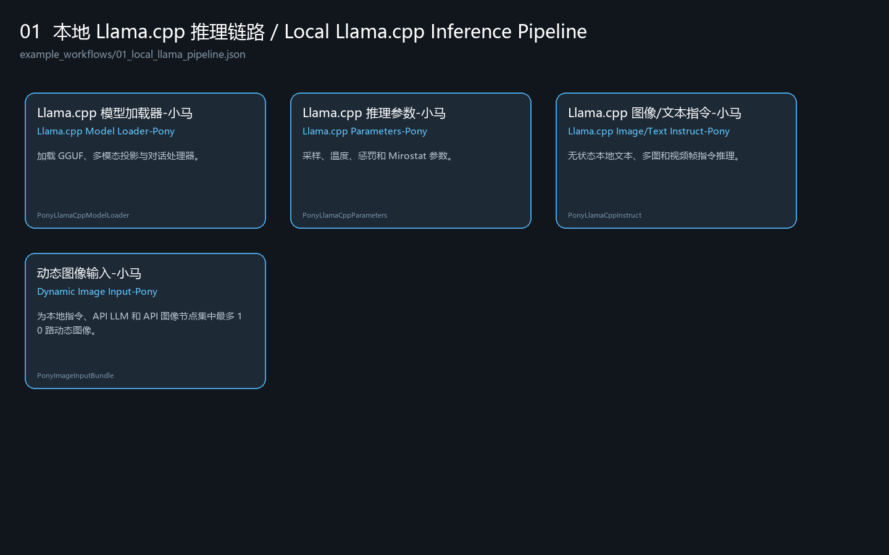
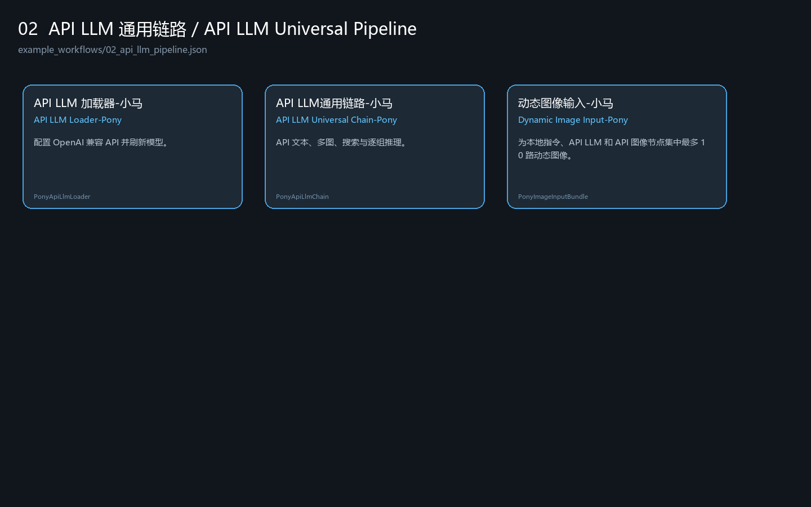
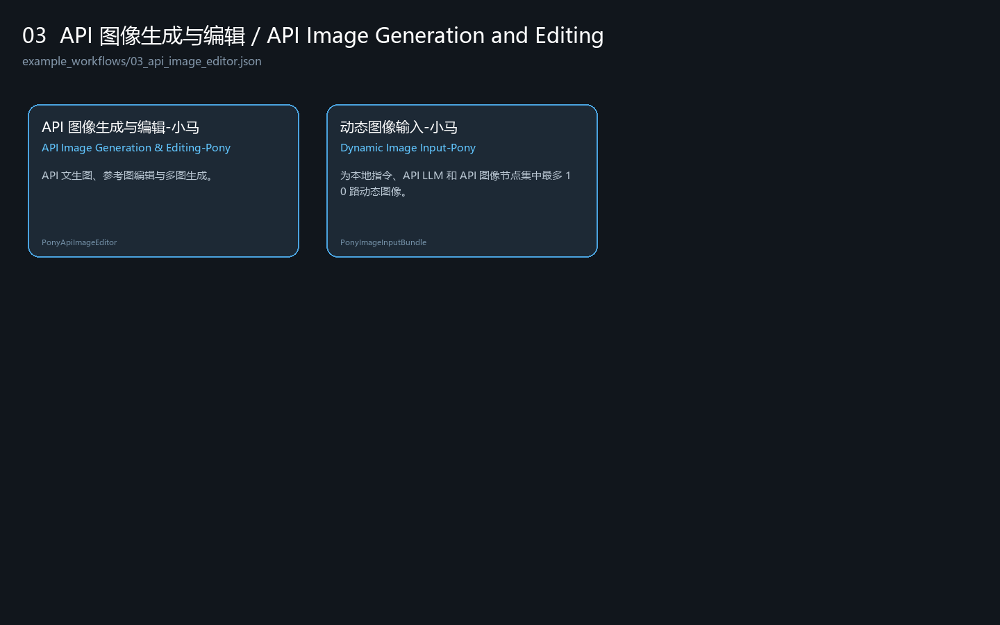
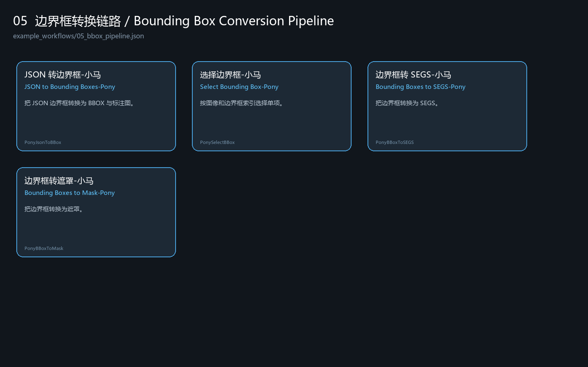
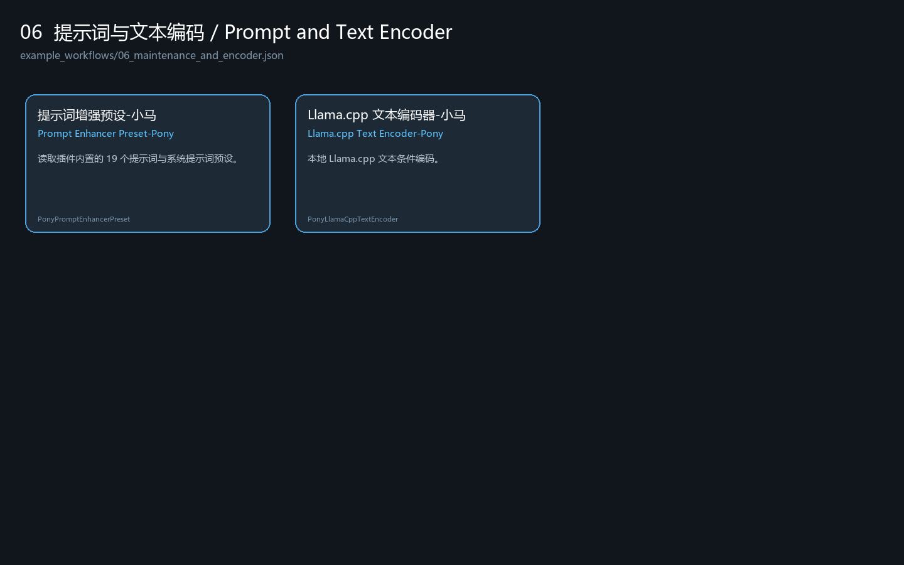
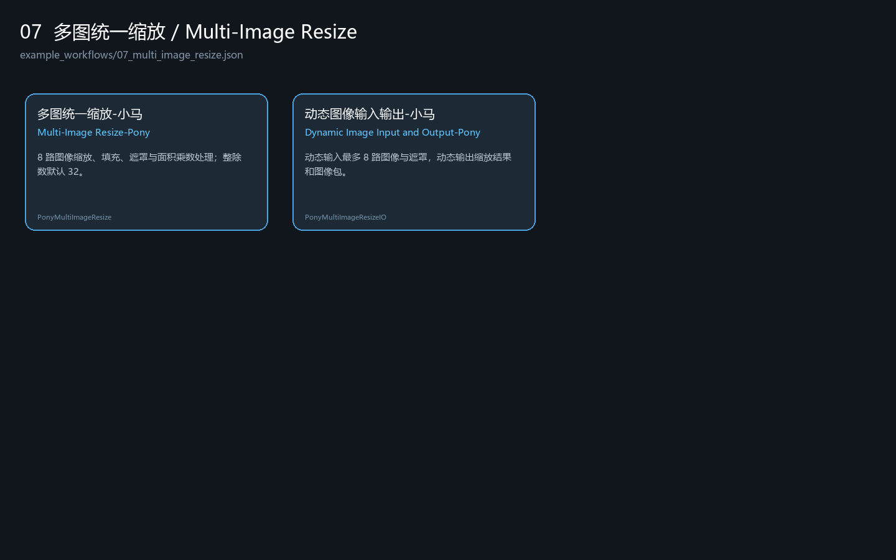
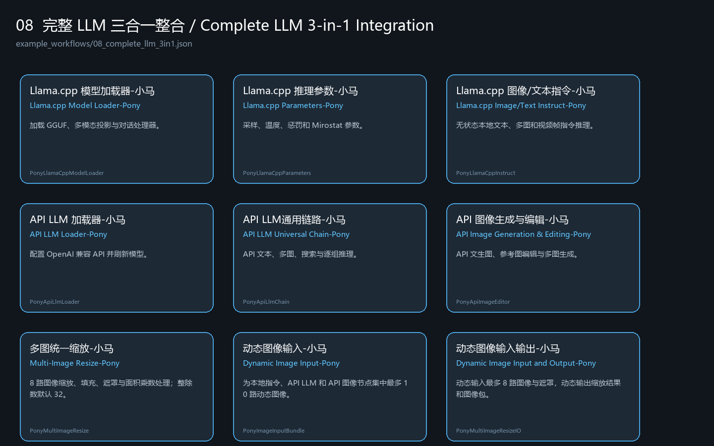

# Pony-llama_cpp and API tools

[English](README.md) | [简体中文](README.zh-CN.md)

Formal plugin name: `Pony-llama_cpp-and-API-tools`. The plugin provides local GGUF/VLM inference, OpenAI-compatible API LLM calls, API image generation and editing, JSON parsing, bounding-box tools, and multi-image resizing.


## Project Introduction

Pony-llama_cpp and API tools is a multifunctional AI toolbox for ComfyUI. It combines local GGUF/VLM inference, OpenAI-compatible API LLMs, API image generation and editing, dynamic image inputs, JSON/bounding-box processing, and eight-image unified resizing.

Built around llama-cpp-python for local inference, the plugin supports text, multi-image, and video-frame understanding. It also provides prompt presets, LoRA and external text-encoder compatibility, dynamic interface repair, VRAM unloading strategies, and complete Chinese/English interface localization. In addition to local models, compatible APIs can be used for cloud text and image models, allowing local VLM and API workflows to be combined in one ComfyUI workflow.

## Prompt Presets

`Prompt Enhancer Preset-Pony` reads the bundled files in `support/prompt_enhancer_presets`.

## Core Features

Core Features
- **Unified local and cloud workflows**: Local GGUF/VLM, API LLM, and API image generation/editing can work together in one workflow.
- **Multimodal local inference**: Accepts text, multiple images, image batches, video-frame sequences, and supported AUDIO input for image description, reverse prompting, prompt optimization, OCR, visual grounding, video analysis, and audio transcription.
- **Model configuration is flexible: GGUF models, `mmproj` visual projection, dialogue processors, context length and GPU memory limits, KV cache, MoE settings, Mtp can all be configured independently.
- **No fixed model list**: Available models depend on the installed llama-cpp-python version, GGUF model, and selected Chat Handler, allowing compatible models to be added later.
- **Robust multi-image inputs**: Local Instruct, API LLM, and API image nodes use stable dynamic image-input regions, automatically repairing slots after image changes, workflow switches, and pasted templates.
- **Video-frame analysis**: Image batches can be treated as video, with configurable maximum frame counts and uniform sampling for reverse prompting, shot analysis, and content summaries.
- **19 built-in prompt presets**: Covers image editing, prompt rewriting, cinematic storyboards, character design, posters, logos, SDXL tags, LTX-2, MiniMax H3, SenseNova, and more, numbered continuously from 01 to 19.
- **Professional visual post-processing**: Includes JSON path extraction, JSON-to-BBOX, bounding-box selection, BBOX-to-SEGS, and BBOX-to-mask for detection, segmentation, and inpainting workflows.
- **Multi-image resize**: Supports up to eight image inputs, an image-1 mask, eight dynamic outputs, a padding mask, dimensions, an execution report, and a combined preview.
- **Complete resize modes**: Supports megapixel limiting, forced megapixel resizing, image-1 manual dimensions/edge mode, and shared-ratio padding.
- **Area-multiplier control**: Both megapixel-limit and force modes can control the area of images 2-8. Force mode uses `image 1 final area × area multiplier` as the target area.
- **Binary megapixels**: All image nodes use `1 MP = 1024 × 1024 = 1,048,576` pixels.
- **Default divisor 32**: New nodes round output width and height down to a multiple of 32 by default. A saved value of `0` in an existing workflow still disables divisor rounding.
- **Dynamic companion node**: **Dynamic Image Input and Output-Pony** automatically attaches above the Multi-Image Resize controller and follows its position, width, and enabled state.
- **Automatic node-group handling**: Groups containing the companion remain correctly bounded after images are added or removed, without breaking group enable, mute, or bypass behavior.
- **External links take effect**: External float, integer, string, and dynamic-node links override stale controller values and can pass runtime parameters to the companion.
- **API image protocol compatibility**: Supports OpenAI Images, Gemini, Nano Banana-compatible mode, Chat Completions image requests, generic JSON, and generic Multipart requests.
- **Complete localization**: Bundled `en`, `zh`, and `zh-CN` locales localize node titles, interfaces, tooltips, and multilingual combo options according to the ComfyUI interface language; no external translation plugin is required.
- **Self-contained release**: Prompt presets, locales, example workflows, and screenshots are packaged with the plugin and do not depend on other Pony plugins.

## Visual Detection and Inpainting

The plugin can convert coordinate JSON returned by a local VLM into visual data usable by ComfyUI:

Llama.cpp Image/Audio/Text Instruct
    → JSON to Bounding Boxes
    → Select Bounding Box
    → Bounding Box to Mask
    → Inpainting

For region refinement or SEGS-based workflows, you can also use:

JSON to Bounding Boxes
    → Bounding Boxes to SEGS
    → Detailer/sampling nodes

## Use Cases

- Local image reverse prompting, multi-image understanding, and video content analysis
- Image-editing prompt rewriting and high-quality prompt expansion
- Workflow assistance for Qwen-Image, FLUX, Wan, LTX-2, MiniMax H3, and related models
- Multi-image conversations, web search, and grouped inference through OpenAI-compatible APIs
- API text-to-image, reference-image editing, and multi-image generation
- Conversion of detection results into masks, SEGS, or inpainting regions
- Unified sizing, padding, masking, and pixel-area control for mixed-resolution assets

## Localization

The plugin includes complete Chinese and English resources:

locales/en/nodeDefs.json
locales/zh/nodeDefs.json
locales/zh-CN/nodeDefs.json

Node names, input/output labels, tooltips, Multi-Image Resize combo options, and prompt-preset names automatically follow the ComfyUI `Comfy.Locale` setting. Bilingual underlying values remain unchanged, so switching languages does not lose workflow parameters.

If external ComfyUI translation plugins are used, avoid overwriting the same node translation files to prevent conflicts between different translations.

## Nodes

| Node ID | English display name | Chinese display name | Function |
|---|---|---|---|
| `PonyLlamaCppModelLoader` | Llama.cpp Model Loader-Pony | Llama.cpp 模型加载器-小马 | Load GGUF, multimodal projection, and chat handler. |
| `PonyLlamaCppInstruct` | Llama.cpp Image/Audio/Text Instruct-Pony | Llama.cpp 图像/音频/文本指令-小马 | Local text, multi-image, video-frame, and supported audio inference. |
| `PonyLlamaCppParameters` | Llama.cpp Parameters-Pony | Llama.cpp 推理参数-小马 | Sampling, temperature, penalties, and Mirostat controls. |
| `PonyParseJson` | Parse JSON-Pony | 解析 JSON-小马 | Read a JSON value by path and output common types. |
| `PonyJsonToBBox` | JSON to Bounding Boxes-Pony | JSON 转边界框-小马 | Convert JSON boxes into BBOX data and an annotated image. |
| `PonyBBoxToSEGS` | Bounding Boxes to SEGS-Pony | 边界框转 SEGS-小马 | Convert bounding boxes into SEGS. |
| `PonyBBoxToMask` | Bounding Boxes to Mask-Pony | 边界框转遮罩-小马 | Convert bounding boxes into a mask. |
| `PonySelectBBox` | Select Bounding Box-Pony | 选择边界框-小马 | Select one box by image and box index. |
| `PonyPromptEnhancerPreset` | Prompt Enhancer Preset-Pony | 提示词增强预设-小马 | Read 19 prompt and system-prompt presets bundled with the plugin. |
| `PonyLlamaCppTextEncoder` | Llama.cpp Text Encoder-Pony | Llama.cpp 文本编码器-小马 | Encode text conditioning with a local llama.cpp model. |
| `PonyApiLlmLoader` | ☁️API LLM Loader-Pony | ☁️API LLM 加载器-小马 | Configure an OpenAI-compatible API and refresh models. |
| `PonyApiLlmChain` | ☁️API LLM Universal Chain-Pony | ☁️API LLM通用链路-小马 | API text, multi-image, search, and grouped inference. |
| `PonyApiImageEditor` | ☁️API Image Generation & Editing-Pony | ☁️API 图像生成与编辑-小马 | API text-to-image, reference editing, and multi-image generation. |
| `PonyMultiImageResize` | Multi-Image Resize-Pony | 多图统一缩放-小马 | Resize eight images with padding, masks, area multipliers, and default divisor 32. |
| `PonyMultiImageResizeIO` | Dynamic Image Input and Output-Pony | 动态图像输入输出-小马 | Dynamically input up to eight images and masks, then output resized images and a bundle. |
| `PonyImageInputBundle` | Dynamic Image Input-Pony | 动态图像输入-小马 | Collect up to ten dynamic images for local Instruct, API LLM, and API image nodes. |

This release only registers the new `Pony*` node IDs and does not provide legacy-ID aliases.

## Example Workflows

- [Local Llama.cpp Inference Pipeline](example_workflows/01_local_llama_pipeline.json)
- [API LLM Universal Pipeline](example_workflows/02_api_llm_pipeline.json)
- [API Image Generation and Editing](example_workflows/03_api_image_editor.json)
- [JSON Parsing](example_workflows/04_json_cleanup.json)
- [Bounding Box Conversion Pipeline](example_workflows/05_bbox_pipeline.json)
- [Prompt and Text Encoder](example_workflows/06_maintenance_and_encoder.json)
- [Multi-Image Resize](example_workflows/07_multi_image_resize.json)
- [Complete LLM 3-in-1 Integration](example_workflows/08_complete_llm_3in1.json)

## Screenshots

### Local Llama.cpp Inference Pipeline



### API LLM Universal Pipeline



### API Image Generation and Editing



### JSON Parsing


### Bounding Box Conversion Pipeline



### Prompt and Text Encoder



### Multi-Image Resize



### Complete LLM 3-in-1 Integration




## Installation

Place the plugin in:

```text
ComfyUI/custom_nodes/Pony-llama_cpp-and-API-tools
```

Install the dependencies using ComfyUI's Python environment:

```bash
python -m pip install -r requirements.txt
```

Restart ComfyUI after changing Python files and refresh the browser after changing frontend files.

Wheel downloads
https://github.com/JamePeng/llama-cpp-python

Example wheel installation command: `python.exe -m pip install "llama_cpp_python-0.4.1+cu130-cp312-cp312-win_amd64.whl"`

Example wheel uninstall command: `python.exe -m pip uninstall llama-cpp-python -y`

## Local Models

Place GGUF models in:

```text
ComfyUI/models/LLM
```

For image recognition with a local VLM, select the matching `mmproj`.

## API Configuration

The API LLM and API image nodes support OpenAI-compatible endpoints and explicitly selected provider protocols. API keys entered in nodes may be stored in workflows; clear them before sharing.


## Credits
* [ComfyUI-llama-cpp_vlm](https://github.com/lihaoyun6/ComfyUI-llama-cpp_vlm) @lihaoyun6
* [llama-cpp-python](https://github.com/JamePeng/llama-cpp-python) @JamePeng
* [ComfyUI-llama-cpp](https://github.com/kijai/ComfyUI-llama-cpp) @kijai
* [ComfyUI](https://github.com/comfyanonymous/ComfyUI) @comfyanonymous
