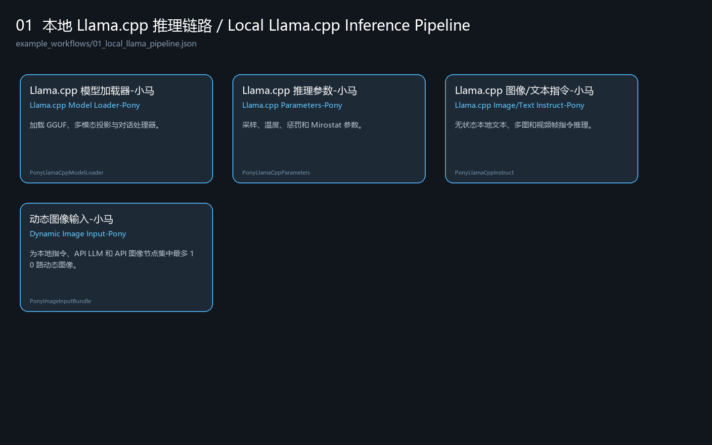
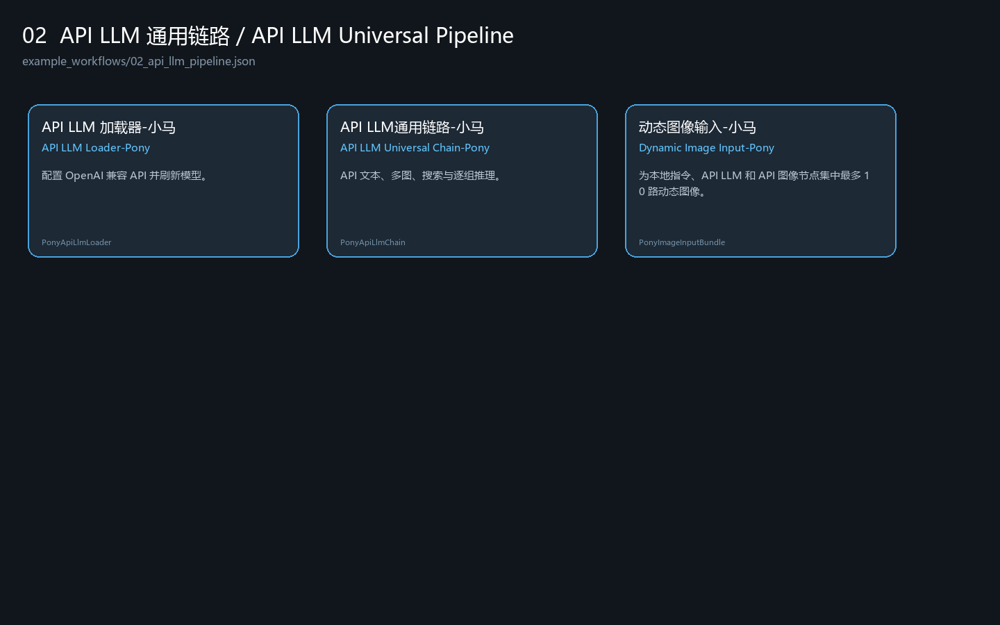
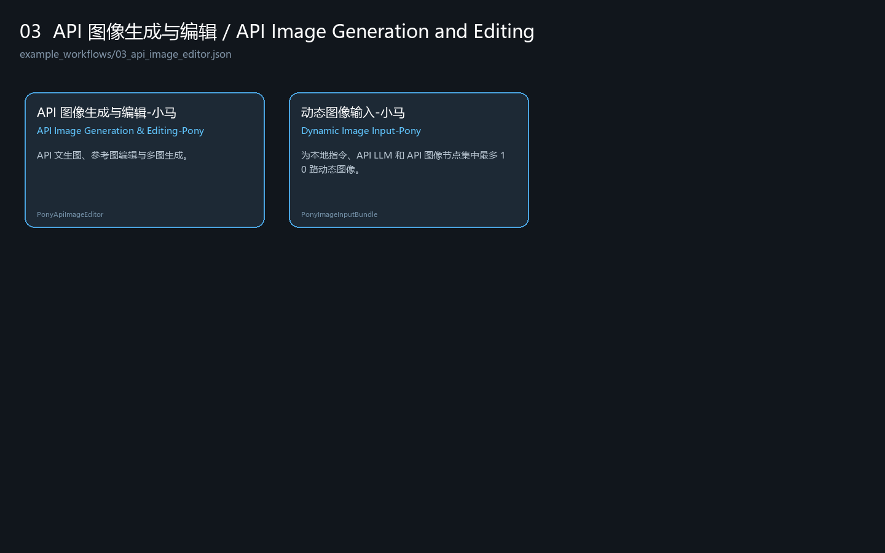
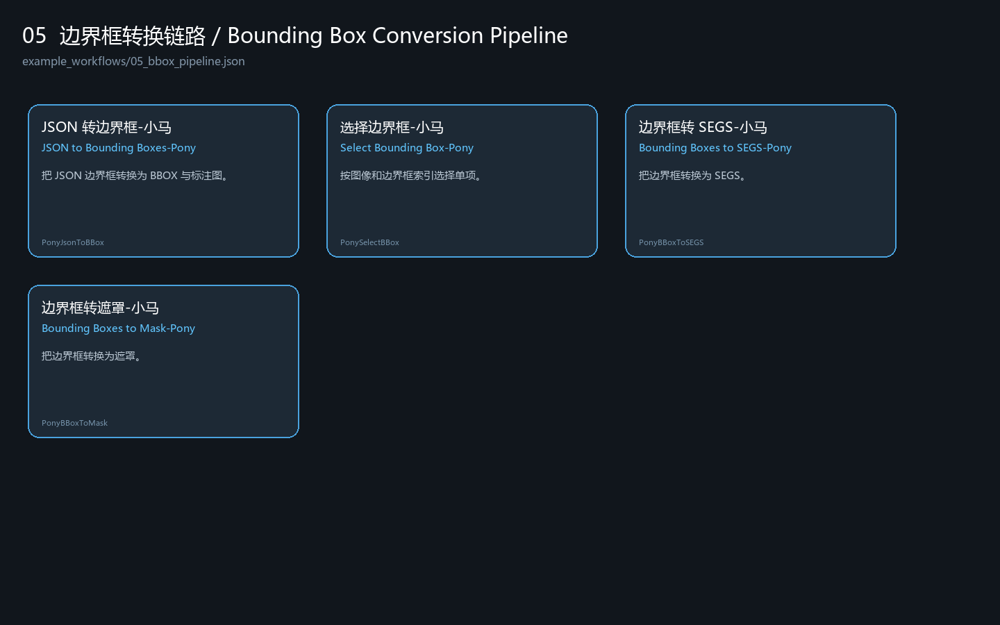
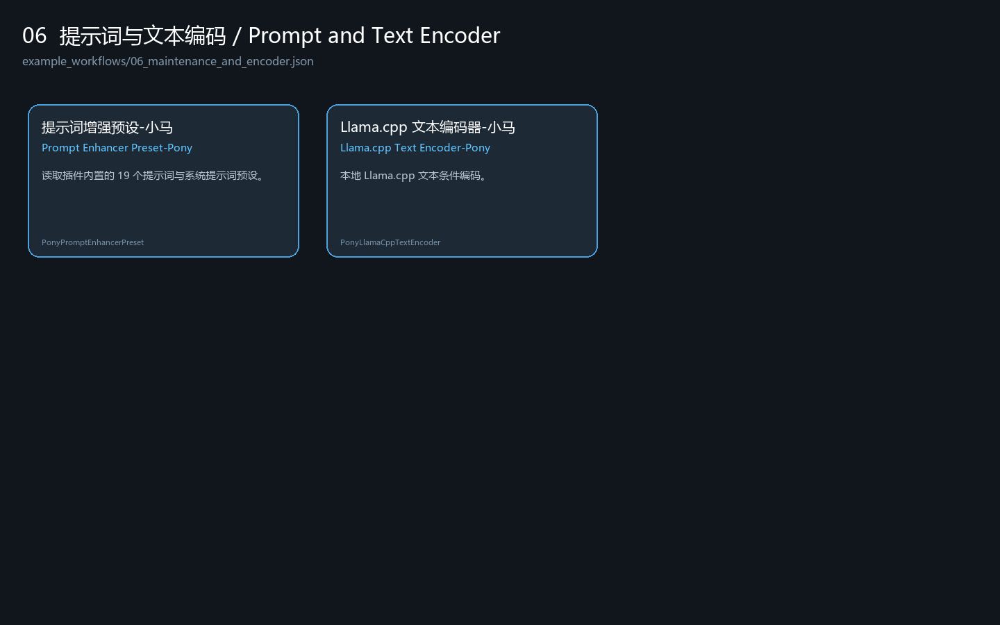
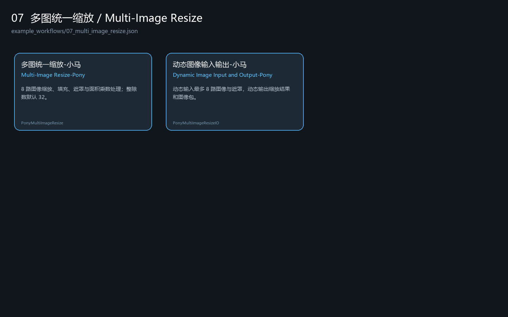
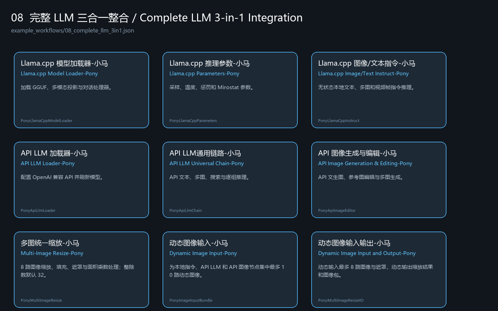

# Pony-llama_cpp and API tools

[English](README.md) | [简体中文](README.zh-CN.md)

插件正式名称：`Pony-llama_cpp-and-API-tools`。本插件覆盖本地 GGUF/VLM 推理、OpenAI 兼容 API LLM、API 图像生成与编辑、JSON 解析、边界框工具和多图统一缩放。


## 项目简介

Pony-llama_cpp and API tools 是一款面向 ComfyUI 的多功能 AI 工具箱，集成本地 GGUF/VLM 推理、OpenAI 兼容 API LLM、API 图像生成与编辑、动态图像输入、JSON/边界框处理和 8 路图像统一缩放。

插件以 llama-cpp-python 为本地推理核心，支持文本、多图和视频帧理解，并提供提示词预设、LoRA 与外部文本编码器兼容、动态接口修复、显存卸载策略和完整的中英文界面适配。除本地模型外，也可以通过兼容 API 调用云端文本模型和图像模型，将本地 VLM 与 API 工作流组合在同一套 ComfyUI 工作流中。

## 提示词预设

`提示词增强预设-小马` 读取 `support/prompt_enhancer_presets` 中的内置文件。

## 核心特色

核心特色
- 本地与云端统一工作流：本地 GGUF/VLM、API LLM 和 API 图像生成/编辑可在同一个工作流中协作。
- 多模态本地推理：支持文本、多图、图片 Batch、视频帧序列和受支持的 AUDIO 输入，可执行图像描述、反推、提示词优化、OCR、视觉定位、视频内容分析和音频转写。
- 模型配置灵活：GGUF 模型、`mmproj` 视觉投影、对话处理器、上下文长度和显存限制、KV 缓存、MoE设置、Mtp均可独立配置。
- 无需固定模型列表：实际可用模型取决于当前 llama-cpp-python、GGUF 模型和所选 Chat Handler，支持后续兼容模型扩展。
- 完善的多图输入：本地 Instruct、API LLM 和 API 图像节点使用稳定的动态图像输入区域，可在增删图像、切换工作流和粘贴模板后自动修复连接槽位。
- 视频帧分析：可将图像 Batch 按视频处理，设置最大帧数并均匀采样，用于视频反推、镜头分析和内容总结。
- 19 个内置提示词预设：覆盖图像编辑、提示词改写、电影分镜、角色设定、海报、Logo、SDXL 标签、LTX-2、MiniMax H3 和 SenseNova 等场景，按 01-19 连续编号。
- 专业的视觉后处理：提供 JSON 路径读取、JSON 转 BBOX、边界框选择、BBOX 转 SEGS 和 BBOX 转遮罩，可衔接检测、分割和局部重绘工作流。
- 多图统一缩放：支持最多 8 路图像、图1遮罩、8 路动态输出、扩展遮罩、尺寸报告和多图预览。
- 缩放模式完整：支持百万像素限制、强制百万像素、图1手动尺寸/边模式和统一比例填充。
- 面积乘数控制：百万像素限制和强制模式下均可控制图2-8面积，强制模式使用“图1最终面积 × 面积乘数”作为目标面积。
- 二进制百万像素：所有图像节点统一使用 `1 MP = 1024 × 1024 = 1,048,576` 像素。
- 整除数默认 32：新节点默认将输出宽高向下取整到 32 的倍数，已有工作流保存的 0 仍表示关闭整除。
- 动态伴随节点：多图统一缩放主节点上方自动吸附“动态图像输入输出-小马”，自动跟随主节点位置、宽度和启用状态。
- 自动节点组适配：伴随节点增删图像后，所属节点组会保留在组内，避免影响组的启用、静音和绕过功能。
- 外部连线生效：外部浮点、整数、字符串和动态节点连接可覆盖主节点旧控件值，并支持向伴随节点传递运行时参数。
- API 图像协议兼容：支持 OpenAI Images、Gemini、Nano Banana 兼容模式、Chat Completions 图像、通用 JSON 和通用 Multipart 请求。
- 完整中英文适配：内置 en、`zh`、`zh-CN` locale，节点标题、接口、提示文字和多语言下拉选项会跟随 ComfyUI 界面语言，不需要额外汉化插件。
- 发布包独立运行：提示词预设、locale、示例工作流和截图均包含在插件目录内，不依赖其它 Pony 插件。

## 视觉检测与局部重绘

插件可将本地 VLM 返回的坐标 JSON 转成 ComfyUI 可用的视觉数据：
Llama.cpp 图像/音频/文本指令
    → JSON 转边界框
    → 选择边界框
    → 边界框转遮罩
    → 局部重绘
需要区域细化或 SEGS 工作流时，也可以：
JSON 转边界框
    → 边界框转 SEGS
    → 细化/采样节点

## 适用场景

- 本地图片反推、多图理解和视频内容分析
- 图像编辑提示词改写和高质量提示词扩写
- Qwen-Image、FLUX、Wan、LTX-2、MiniMax H3 等模型的工作流辅助
- OpenAI 兼容 API 的多图对话、联网搜索和分组推理
- API 文生图、参考图编辑和多图生成
- 目标检测结果转遮罩、SEGS 或局部重绘
- 多分辨率素材统一尺寸、填充、遮罩和像素面积控制

## 中英文适配

插件已内置完整的中文和英文资源，并提供：
locales/en/nodeDefs.json
locales/zh/nodeDefs.json
locales/zh-CN/nodeDefs.json
节点名称、输入输出标签、tooltip、多图统一缩放的下拉选项和提示词预设名称会根据 ComfyUI 的 Comfy.Locale 设置自动切换。中英双语底层保存值保持不变，不会因切换语言导致工作流参数丢失。

如需使用外部 ComfyUI 翻译插件，应避免重复覆盖同一节点翻译文件，以免出现不同版本翻译冲突。

## 节点

| 节点 ID | 中文显示名 | 英文显示名 | 功能 |
|---|---|---|---|
| `PonyLlamaCppModelLoader` | Llama.cpp 模型加载器-小马 | Llama.cpp Model Loader-Pony | 加载 GGUF、多模态投影与对话处理器。 |
| `PonyLlamaCppInstruct` | Llama.cpp 图像/音频/文本指令-小马 | Llama.cpp Image/Audio/Text Instruct-Pony | 本地文本、多图、视频帧以及受支持的音频推理。 |
| `PonyLlamaCppParameters` | Llama.cpp 推理参数-小马 | Llama.cpp Parameters-Pony | 采样、温度、惩罚和 Mirostat 参数。 |
| `PonyParseJson` | 解析 JSON-小马 | Parse JSON-Pony | 按路径读取 JSON 并输出常用类型。 |
| `PonyJsonToBBox` | JSON 转边界框-小马 | JSON to Bounding Boxes-Pony | 把 JSON 边界框转换为 BBOX 与标注图。 |
| `PonyBBoxToSEGS` | 边界框转 SEGS-小马 | Bounding Boxes to SEGS-Pony | 把边界框转换为 SEGS。 |
| `PonyBBoxToMask` | 边界框转遮罩-小马 | Bounding Boxes to Mask-Pony | 把边界框转换为遮罩。 |
| `PonySelectBBox` | 选择边界框-小马 | Select Bounding Box-Pony | 按图像和边界框索引选择单项。 |
| `PonyPromptEnhancerPreset` | 提示词增强预设-小马 | Prompt Enhancer Preset-Pony | 读取插件内置的 19 个提示词与系统提示词预设。 |
| `PonyLlamaCppTextEncoder` | Llama.cpp 文本编码器-小马 | Llama.cpp Text Encoder-Pony | 本地 Llama.cpp 文本条件编码。 |
| `PonyApiLlmLoader` | ☁️API LLM 加载器-小马 | ☁️API LLM Loader-Pony | 配置 OpenAI 兼容 API 并刷新模型。 |
| `PonyApiLlmChain` | ☁️API LLM通用链路-小马 | ☁️API LLM Universal Chain-Pony | API 文本、多图、搜索与逐组推理。 |
| `PonyApiImageEditor` | ☁️API 图像生成与编辑-小马 | ☁️API Image Generation & Editing-Pony | API 文生图、参考图编辑与多图生成。 |
| `PonyMultiImageResize` | 多图统一缩放-小马 | Multi-Image Resize-Pony | 8 路图像缩放、填充、遮罩与面积乘数处理；整除数默认 32。 |
| `PonyMultiImageResizeIO` | 动态图像输入输出-小马 | Dynamic Image Input and Output-Pony | 动态输入最多 8 路图像与遮罩，动态输出缩放结果和图像包。 |
| `PonyImageInputBundle` | 动态图像输入-小马 | Dynamic Image Input-Pony | 为本地指令、API LLM 和 API 图像节点集中最多 10 路动态图像。 |

本版本只注册新的 `Pony*` 节点 ID，不提供旧 ID 别名。

## 示例工作流

- [本地 Llama.cpp 推理链路](example_workflows/01_local_llama_pipeline.json)
- [API LLM 通用链路](example_workflows/02_api_llm_pipeline.json)
- [API 图像生成与编辑](example_workflows/03_api_image_editor.json)
- [JSON 解析](example_workflows/04_json_cleanup.json)
- [边界框转换链路](example_workflows/05_bbox_pipeline.json)
- [提示词与文本编码](example_workflows/06_maintenance_and_encoder.json)
- [多图统一缩放](example_workflows/07_multi_image_resize.json)
- [完整 LLM 三合一整合](example_workflows/08_complete_llm_3in1.json)

## 功能截图

### 本地 Llama.cpp 推理链路



### API LLM 通用链路



### API 图像生成与编辑



### JSON 解析


### 边界框转换链路



### 提示词与文本编码



### 多图统一缩放



### 完整 LLM 三合一整合




## 安装

将插件放在：

```text
ComfyUI/custom_nodes/Pony-llama_cpp-and-API-tools
```

使用 ComfyUI 的 Python 环境安装依赖：

```bash
python -m pip install -r requirements.txt
```

修改 Python 文件后重启 ComfyUI；修改前端文件后刷新浏览器。

轮子下载
https://github.com/JamePeng/llama-cpp-python

安装轮子命令例如：python.exe -m pip install "llama_cpp_python-0.4.1+cu130-cp312-cp312-win_amd64.whl"
更新轮子卸载指令：python.exe -m pip uninstall llama-cpp-python -y

## 本地模型

GGUF 模型放在：

```text
ComfyUI/models/LLM
```

本地 VLM 进行图像识别时，请选择匹配的 `mmproj`。

## API 配置

API LLM 与 API 图像节点支持 OpenAI 兼容接口及明确选择的专用协议。节点内填写的密钥可能保存到工作流，分享前请清除。


## 致谢
* [ComfyUI-llama-cpp_vlm](https://github.com/lihaoyun6/ComfyUI-llama-cpp_vlm) @lihaoyun6
* [llama-cpp-python](https://github.com/JamePeng/llama-cpp-python) @JamePeng
* [ComfyUI-llama-cpp](https://github.com/kijai/ComfyUI-llama-cpp) @kijai
* [ComfyUI](https://github.com/comfyanonymous/ComfyUI) @comfyanonymous
